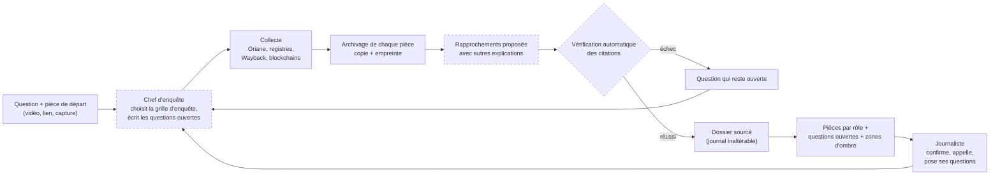

# Hack Oriane : l'enquête qui sait ce qu'elle ignore

Projet du hackathon « Hack the Feed » (Albert School, 7 novembre 2026), track Brut.

**La promesse.** Un journaliste de Brut ouvre son sujet avec la liste numérotée de ce qui reste ouvert ; l'outil la raccourcit pièce à l'appui et s'arrête aux questions où il faut un humain.

## Pour qui, et quelle question

L'utilisateur est un journaliste d'enquête de Brut qui démarre un sujet : une arnaque en ligne, une rumeur qui circule, une vidéo envoyée par un abonné. Il se pose chaque fois les mêmes questions :

- D'où vient cette information, et qui l'a dite en premier ?
- Qui la pousse, et à qui profite-t-elle ?
- Qui appeler ?
- Qu'est-ce que je ne sais pas encore ?

Aujourd'hui, ces réponses sont éparpillées entre des plateformes fermées, des vidéos que personne ne fouille et des registres. L'outil les réunit et garde, pour chacune, la pièce qui la prouve.

## Ce que fait l'outil

Chaque rubrique porte son état : **codé** (le dépôt le fait et un test le couvre), **en partie** (une brique existe, l'ensemble non) ou **prévu** (écrit ici pour le lecteur, aucun code dans ce dépôt à ce stade).

**Une question au centre, des pièces rangées par rôle** (codé : le modèle de données et le serveur local). Le journaliste pose sa question (le nom d'une affaire, un sujet). Autour d'elle, les pièces sont rangées par rôle dans l'affaire : plus ancienne trace retrouvée, relais, à qui ça profite, moyens techniques, personnes qui se disent lésées, témoins directs, experts, voix contraires, mis en cause, zones d'ombre. Chaque pièce porte son résumé et un lien vers la publication ou le document d'origine. L'interface est servie à part (voir plus bas).

**Des questions ouvertes, numérotées** (en partie : le modèle d'une question ouverte et ses deux statuts existent ; le choix de la grille et la rédaction des questions par les agents sont prévus). Chaque grille d'enquête (promesse commerciale, rumeur virale, contenus recyclés, faux propos) oblige à chercher des choses précises. Une rubrique de la grille restée sans pièce devient une question ouverte, avec ses pistes. La liste existe avant la première recherche. L'outil la raccourcit en éclaircissant les questions par une pièce que l'on peut rouvrir. Quand la réponse exige un appel ou une démarche, la question reste ouverte et l'outil dit qui peut y répondre.

**Les zones d'ombre** (prévu : le calcul de couverture n'est pas codé). L'outil doit montrer ce qu'il ne voit pas : les comptes sous 5 000 abonnés, les plateformes non couvertes, l'historique limité à trois mois. Chaque zone floue devient une question, avec le coût de la combler. Ces limites figurent déjà, écrites à la main, dans « Limites assumées ».

**À qui ça profite** (en partie : les indices sont codés, le raisonnement est prévu). Le code extrait et pèse les indices concrets (lien en bio, domaine, code promo, SIREN, pseudo réutilisé, canal Telegram, son) dans `enquete/pivots.py`. Le test des quatre pistes de gain (argent, audience, influence, nuisance) est prévu : une piste sans pièce restera une hypothèse.

**L'argent qui bouge** (codé pour les registres publics). Les adresses de portefeuilles crypto sont repérées dans les textes collectés (somme de contrôle vérifiée) et les transactions interrogées sur les registres publics de Bitcoin, des chaînes EVM, de TRON et de Solana, avec la liste de sanctions du Trésor américain. Une transaction n'est retenue que si on la retrouve dans le registre public de la blockchain. Un portefeuille n'est jamais attribué à une personne. Certaines chaînes sont bloquées par un contrôle anti-robot : le module le dit au lieu d'inventer.

**Le compte juste** (en partie). Devant un lot de vidéos qui disent la même chose, l'outil regroupe celles qui partagent la même phrase (une fois mise en forme) ou le même son, et retrouve la date de chaque vidéo à partir de son numéro (codé : `enquete/chaine.py`, `enquete/temps.py`). Il écrit « première trouvée », jamais « première ». Le passage de « N vidéos » à « K sources indépendantes » est **prévu** : une série de vidéos à la même phrase n'est pas encore une source, et le code ne teste ni l'auteur ni l'indépendance. Le rapport de passage donne un nombre de vidéos et de séries, pas un nombre de sources.

### Ce que le dépôt contient aujourd'hui

| Module | Rôle |
|---|---|
| `enquete/sources/oriane.py` | client de l'API Oriane : cache disque, tarifs en crédits, plafond |
| `enquete/sources/infra.py` | domaine, certificats, registre des sociétés, Wayback CDX, lien en bio : sources ouvertes sans clé |
| `enquete/sources/chaines.py` | transactions sur les registres publics des blockchains |
| `enquete/temps.py` | date d'une publication TikTok ou Instagram lue dans son numéro |
| `enquete/liens.py` | lien vers la publication d'origine, reconstruit depuis le numéro et le pseudo |
| `enquete/pivots.py` | indices concrets entre comptes (domaine, code promo, portefeuille…), pesés selon leur rareté |
| `enquete/archive.py` | garde une copie datée de chaque pièce, dont toute retouche se voit : copie, empreinte SHA-256, instantané Wayback, capture de page ; l'horodatage RFC 3161 est écrit mais la chaîne ne l'appelle pas encore |
| `enquete/reseau.py` | le réseau d'enquête : pièces, rôles, liens avec preuve, journal inaltérable |
| `enquete/chaine.py` | chaîne de bout en bout : recherches Oriane, séries de vidéos à la même phrase, dossier sourcé |
| `enquete/recherche.py` | moteur de recherche dans le dossier d'une enquête |
| `enquete/images.py` | une image par pièce : capture d'abord, illustration libre marquée |
| `enquete/serveur.py` | serveur local qui sert le dossier (export, direct, rejeu, recherche, questions du journaliste) |
| `enquete/banc.py` | banc d'essai (voir plus bas) |
| `banc/affaires/` | les affaires de référence, résolues par la presse |

L'interface est dans `interface/` : l'écran d'entrée (`interface/index.html`, servi par le serveur) et la salle de démo sur un cas fictif (`interface/demo/`, voir son `LISEZMOI.md`). Pas encore dans ce dépôt : les agents de raisonnement (chef d'enquête, rédaction des questions, classement des pièces), en cours sur une branche à part.

## Comment ça marche

Le schéma montre la cible. Les cases en pointillés ne sont pas codées dans ce dépôt.



La règle de fond : la machine propose ; une vérification automatique, que l'on peut rejouer, retrouve chaque citation mot pour mot dans sa pièce. Aujourd'hui, le code refuse un lien qui n'a ni adresse, ni citation, ni date de collecte (`reseau.py`) ; la recherche de la citation dans le contenu de la pièce est **prévue**. Le journaliste décide seul des étapes à risque (fusion de deux comptes, mise en cause).

Le détail de la méthode est dans [`docs/methode.md`](docs/methode.md), les limites éthiques et juridiques dans [`docs/ethique.md`](docs/ethique.md).

## Les sources

1. **Oriane** d'abord : moteur de recherche qui lit les vidéos TikTok, Instagram et YouTube (parole horodatée, texte à l'écran, images clés, sons, profils). C'est la seule source vidéo de l'outil.
2. **Sources gratuites, codées** : RDAP et certificats (crt.sh) pour les domaines, API Recherche d'entreprises, Wayback Machine (archive et CDX), registres publics des blockchains et liste de sanctions du Trésor américain, outil local yt-dlp pour la copie des vidéos.
3. **Sources gratuites, prévues** : recherche web générale, GDELT (presse mondiale), BODACC, décisions publiques des autorités (ANSM, AMF, DGCCRF), aperçu web public de Telegram, Bluesky, transcription locale.

Aucune de ces sources ne demande de clé payante. Seule la clé Oriane est requise.

## Les règles de preuve

1. **Aucun lien sans preuve déclarée.** Un lien porte une adresse, une citation et, pour une vidéo, une seconde. `reseau.py` refuse de construire un lien sans cela. Une intuition sans preuve reste une piste, jamais un trait sur la carte. *Prévu* : retrouver la citation dans la pièce, à la seconde annoncée.
2. **Deux notes séparées.** La fiabilité de la source (A à F) et la crédibilité de l'information (1 à 6) se notent à part, et l'interface les traduit en mots (« source habituellement fiable ; information recoupée »). Codé (`Solidite`).
3. **Les autres explications.** Chaque faisceau d'indices doit être confronté à une autre explication (coïncidence, tendance, même source, copie, même auteur, coordination). Le lien écrit nomme celle qui gagne et celles qu'il écarte, avec la preuve qui les écarte. Le modèle de données le porte ; la rédaction par les agents est prévue.
4. **Le poids de la rareté.** Un hashtag populaire ne prouve rien, un code promo identique sur deux comptes prouve beaucoup. Plus un point commun est rare dans les vidéos collectées, plus il compte (`pivots.py`). Deux indices rares et indépendants doivent valoir plus que dix indices de la même source (prévu : le calcul actuel ne vérifie pas l'indépendance).
5. **Un banc d'essai.** L'outil joue des affaires déjà résolues par la presse, et son rendu est comparé à l'affaire de référence : part des faits retrouvés, part des faits affirmés qui tiennent, faits non étayés, fausses pistes écartées. Aucun nom, date ou fait d'une affaire du banc n'entre dans une consigne d'agent. Une affaire de réserve n'est jouée qu'une seule fois, à la fin : le programme écrit une trace et refuse tout second passage. Le chiffre de la réserve est celui qu'on montre.

Le résultat du banc d'essai sera ajouté ici quand il existera.

## Limites assumées

- **Facebook et X ne sont pas couverts** par l'index d'Oriane. Quand une rumeur naît là, l'outil doit écrire « hors du champ de l'outil » et nommer qui peut voir (prévu : aujourd'hui, la limite n'est écrite que dans ce document).
- **Fenêtre de trois mois** dans l'index d'Oriane, comptes de moins de 5 000 abonnés absents, retard possible sur les derniers jours.
- **Les vidéos-réponses (duos, stitchs) ne sont pas visibles.**
- **L'outil ne remonte ni adresse e-mail ni numéro de téléphone.**
- **Personne n'est nommé ni accusé sans source solide.** Pas de « coupable », de « bot » ni de « faux compte ». Les mineurs ne sont ni nommés, ni affichés, ni proposés comme interlocuteurs. Aucune reconnaissance de visage ou de voix. Une personne privée n'entre dans un rôle qu'après un clic du journaliste. Ce sont des engagements : les contrôles automatiques qui les imposent sont **prévus** ; le détail est dans [`docs/ethique.md`](docs/ethique.md).
- **Les copies de pièces échouent parfois.** Sur le premier passage réel (séismes, 2 pièces tentées), aucune copie n'a abouti entièrement et aucun instantané Wayback n'a été obtenu (mesure du 7 nov. 2026 sur `passage.json`, non versionné).
- Le banc d'essai mesure l'outil sur quelques affaires déjà résolues. Ce n'est pas une fiabilité générale.

## Installation

Python 3.12 ou plus récent.

```bash
python -m venv .venv
source .venv/bin/activate      # Windows : .venv\Scripts\activate
pip install -e ".[dev]"
```

L'archivage par capture de page (facultatif) demande en plus :

```bash
pip install -e ".[archive]"
playwright install chromium
```

Sous Windows, ajouter `set PYTHONUTF8=1` (ou `$env:PYTHONUTF8 = "1"` dans PowerShell) avant les commandes ci-dessous pour que les accents s'affichent.

### La clé Oriane

Créer un fichier `.env` à la racine (il est ignoré par git) :

```
ORIANE_API_KEY=
```

Renseigner la clé à droite du signe égal. Elle peut aussi venir de la variable d'environnement `ORIANE_API_KEY`.

## Commandes

Lancer une enquête de bout en bout (appelle Oriane, consomme des crédits) :

```bash
python -m enquete.chaine "Stylos minceur : qui est derrière ?" \
  --mots "stylo minceur, stylo ozempic" --plafond-credits 600 --env .env
```

Options utiles : `--depuis AAAA-MM-JJ` (ne garder que les vidéos récentes), `--nom` (nom du dossier de sortie), `--archives 0` (aucune archive), `--sortie` (par défaut `donnees/`, ignoré par git), `--cache` (par défaut `cache/oriane`, une requête identique ne coûte rien deux fois). La chaîne s'arrête proprement au plafond de crédits et écrit `reseau.json`, `rendu-banc.json` et `passage.json`.

Comparer un rendu à une affaire de référence :

```bash
python -m enquete.banc banc/affaires/exemple-fictif.json mon-rendu.json
```

Le format des affaires de référence et des rendus est décrit dans [`banc/README.md`](banc/README.md).

## Tests

```bash
python -m pytest
```

Les tests n'appellent ni Oriane ni aucun modèle de langage : les réponses d'Oriane viennent d'un fichier anonymisé (`tests/reponses/`).

---

## In English

**Hack Oriane** is a tool for Brut's investigative journalists, built for the "Hack the Feed" hackathon (Albert School, 7 November 2026). A reporter starting a story gets a numbered list of open questions. The tool is meant to shorten that list by attaching evidence to each question, and to stop at the questions that need a human. Evidence is organised by role around the central question.

Status: this repository holds the data model (an append-only evidence network), the Oriane client, date decoding from post IDs, clustering of videos sharing a phrase, evidence archiving, pivot extraction, open-source enrichment, blockchain tracing, a local server and a benchmark. The interface (entry screen and a demo room on a fictional case) is in `interface/`. Modules for independent-source counting, quote checking and safeguards exist but are not yet wired into the pipeline. The reasoning agents and coverage mapping are in progress, not in this repository yet.

Video comes from the Oriane search API (TikTok, Instagram, YouTube). Everything else uses free sources: company registry, domain records, Wayback Machine, public blockchain explorers.

Proof rules: no link without a declared URL and quote (checking the quote inside the source is planned); source reliability and information credibility are scored separately; rare coincidences weigh more than common ones; a benchmark replays cases already solved by the press, with one held-out case that can be run only once. Limits: Facebook and X are not covered, Oriane's index covers three months, email and phone leads are not followed, and nobody is named or accused without a solid source (a commitment today, enforced by code later; see [`docs/ethique.md`](docs/ethique.md)).

Setup: Python 3.12+, `pip install -e ".[dev]"`, put `ORIANE_API_KEY` in a `.env` file, run `python -m pytest`. French documentation above; the method is in [`docs/methode.md`](docs/methode.md).
