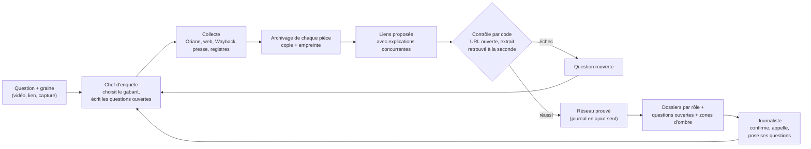

# Hack Oriane : l'enquête qui sait ce qu'elle ignore

Projet du hackathon « Hack the Feed » (Albert School, 7 novembre 2026), track Brut.

**La promesse.** Un journaliste de Brut ouvre son sujet avec la liste numérotée de ce qui reste ouvert ; l'outil la raccourcit pièce à l'appui et s'arrête aux questions où il faut un humain.

## Pour qui, et quelle question

L'utilisateur est un journaliste d'enquête de Brut qui démarre un sujet : une arnaque en ligne, une rumeur qui circule, une vidéo envoyée par un abonné. Il se pose chaque fois les mêmes questions :

- D'où vient cette information, et qui l'a dite en premier ?
- Qui la pousse, et à qui profite-t-elle ?
- Qui appeler ?
- Qu'est-ce que je ne sais pas encore ?

Aujourd'hui, ces réponses sont éparpillées entre des plateformes fermées, des vidéos que personne ne fouille et des registres. L'outil les réunit et garde, pour chacune, la pièce qui la prouve.

## Ce que fait l'outil

**Une question au centre, des dossiers par rôle.** Le journaliste pose sa question (le nom d'une affaire, un sujet). Autour d'elle, les pièces sont rangées par rôle dans l'affaire : à l'origine, amplificateurs, bénéficiaires, infrastructure, victimes, témoins, experts, contradicteurs, mis en cause, inconnus. Chaque pièce porte son résumé et un lien vers le post ou le document d'origine.

**Des questions ouvertes, numérotées.** Chaque type d'affaire (arnaque commerciale, rumeur virale, contenus recyclés, faux propos) oblige à chercher des choses précises. Une case sans pièce devient une question ouverte, avec ses pistes. La liste existe avant la première recherche. Les agents la raccourcissent en fermant les questions par une pièce que l'on peut rouvrir. Quand la réponse exige un appel ou une démarche, la question reste ouverte et l'outil dit qui peut y répondre.

**Les zones d'ombre.** L'outil montre ce qu'il ne voit pas : les comptes sous 5 000 abonnés, les plateformes non couvertes, l'historique limité à trois mois. Chaque zone floue devient une question, avec le coût de la combler.

**À qui ça profite.** Pour chaque affaire, l'outil teste quatre pistes de gain (argent, audience, influence, nuisance) et ne garde que celles où il peut montrer où passe la valeur. Une piste sans pièce reste une hypothèse.

**L'argent qui bouge.** Lien en bio, boutique, code promo, société, liens de cagnotte et de paiement, adresses de portefeuilles crypto visibles dans une bio, une légende ou à l'écran. Une transaction n'est retenue que si son identifiant est vérifiable sur un explorateur public.

**Le compte juste.** Devant un lot de vidéos qui disent la même chose, l'outil compte combien de sources indépendantes se cachent derrière, et date chaque vidéo à partir de son identifiant. Il écrit « première trouvée », jamais « première ».

### Ce que le dépôt contient aujourd'hui

| Module | Rôle |
|---|---|
| `enquete/sources/oriane.py` | client de l'API Oriane : cache disque, tarifs en crédits, plafond |
| `enquete/temps.py` | date d'une publication TikTok ou Instagram lue dans son identifiant |
| `enquete/liens.py` | lien vers le post d'origine, reconstruit depuis l'identifiant et le pseudo |
| `enquete/archive.py` | archivage d'une preuve à son entrée : copie, empreinte SHA-256, Wayback, horodatage RFC 3161 |
| `enquete/reseau.py` | le réseau d'enquête : nœuds, rôles, liens avec preuve, journal en ajout seul |
| `enquete/chaine.py` | chaîne de bout en bout : recherches Oriane, grappes de vidéos identiques, réseau prouvé |
| `enquete/banc.py` | banc d'essai (voir plus bas) |
| `banc/affaires/` | les corrigés d'affaires résolues par la presse |

L'interface (le réseau cliquable) et les agents de raisonnement ne sont pas dans ce dépôt à ce stade.

## Comment ça marche



La règle de fond : l'intelligence propose, le code vérifie. Un lien proposé par un agent n'est dessiné qu'après avoir passé un contrôle mécanique. S'il échoue, le lien disparaît et la question se rouvre. Le journaliste décide seul des étapes à risque (fusion de deux comptes, mise en cause).

Le détail de la méthode est dans [`docs/methode.md`](docs/methode.md).

## Les sources

1. **Oriane** d'abord : moteur de recherche qui lit les vidéos TikTok, Instagram et YouTube (parole horodatée, texte à l'écran, images clés, sons, profils). C'est la seule source vidéo de l'outil.
2. **Sources gratuites ensuite** : recherche web et lecture de pages, Wayback Machine, GDELT (presse mondiale), aperçu web public de Telegram, Bluesky, API Recherche d'entreprises et BODACC, décisions publiques des autorités (ANSM, AMF, DGCCRF), outils locaux (yt-dlp, transcription locale).

Aucune de ces sources ne demande de clé payante. Seule la clé Oriane est requise.

## Les règles de preuve

1. **Aucun lien sans preuve vérifiée par du code.** Un lien porte une URL, un extrait exact et une seconde. `reseau.py` refuse de construire un lien sans preuve. Une intuition sans preuve reste une piste, jamais un trait sur la carte.
2. **Deux notes séparées.** La fiabilité de la source (A à F) et la crédibilité de l'information (1 à 6) se notent à part, et l'interface les traduit en mots (« source habituellement fiable ; information recoupée »).
3. **Les explications concurrentes.** Chaque lien fort a une explication innocente (coïncidence, tendance, même source, copie, même auteur, coordination). Le lien écrit nomme celle qui gagne et celles qu'il écarte, avec la preuve qui les écarte.
4. **Le poids de la rareté.** Un hashtag populaire ne prouve rien, un code promo identique sur deux comptes prouve beaucoup. Le poids d'un indice vaut à peu près −log de sa fréquence dans le corpus. Deux indices rares et indépendants valent plus que dix indices de la même source.
5. **Un banc d'essai anti-triche.** L'outil joue des affaires déjà résolues par la presse, et son rendu est comparé au corrigé : rappel pondéré, précision, faits inventés, pièges évités. Aucun nom, date ou fait d'une affaire du banc n'entre dans une consigne d'agent. Une affaire de réserve n'est jouée qu'une seule fois, à la fin : le programme écrit une trace et refuse tout second passage. Le chiffre de la réserve est celui qu'on montre.

Le score du banc sera ajouté ici quand il existera.

## Limites assumées

- **Facebook et X ne sont pas couverts** par l'index d'Oriane. Quand une rumeur naît là, l'outil écrit « hors de ma portée » et nomme qui peut voir.
- **Fenêtre de trois mois** dans l'index d'Oriane, comptes de moins de 5 000 abonnés absents, jusqu'à une semaine de retard.
- **Les duos et stitchs ne sont pas visibles.**
- **Les pistes par e-mail et par téléphone sont désactivées.**
- **Personne n'est nommé ni accusé sans source solide.** Pas de « coupable », de « bot » ni de « faux compte ». Les mineurs ne sont ni nommés, ni affichés, ni proposés comme interlocuteurs. Aucune reconnaissance de visage ou de voix. Une personne privée n'entre dans un rôle qu'après un clic du journaliste.
- Le score du banc mesure l'outil sur quelques affaires. Ce n'est pas une fiabilité générale.

## Installation

Python 3.12 ou plus récent.

```bash
python -m venv .venv
source .venv/bin/activate      # Windows : .venv\Scripts\activate
pip install -e ".[dev]"
```

L'archivage par capture de page (facultatif) demande en plus :

```bash
pip install -e ".[archive]"
playwright install chromium
```

Sous Windows, ajouter `set PYTHONUTF8=1` (ou `$env:PYTHONUTF8 = "1"` dans PowerShell) avant les commandes ci-dessous pour que les accents s'affichent.

### La clé Oriane

Créer un fichier `.env` à la racine (il est ignoré par git) :

```
ORIANE_API_KEY=
```

Renseigner la clé à droite du signe égal. Elle peut aussi venir de la variable d'environnement `ORIANE_API_KEY`.

## Commandes

Lancer une enquête de bout en bout (appelle Oriane, consomme des crédits) :

```bash
python -m enquete.chaine "Stylos minceur : qui est derrière ?" \
  --mots "stylo minceur, stylo ozempic" --plafond-credits 600 --env .env
```

Options utiles : `--depuis AAAA-MM-JJ` (ne garder que les vidéos récentes), `--nom` (nom du dossier de sortie), `--archives 0` (aucune archive), `--sortie` (par défaut `donnees/`, ignoré par git), `--cache` (par défaut `cache/oriane`, une requête identique ne coûte rien deux fois). La chaîne s'arrête proprement au plafond de crédits et écrit `reseau.json`, `rendu-banc.json` et `passage.json`.

Comparer un rendu au corrigé d'une affaire :

```bash
python -m enquete.banc banc/affaires/exemple-fictif.json mon-rendu.json
```

Le format des corrigés et des rendus est décrit dans [`banc/README.md`](banc/README.md).

## Tests

```bash
python -m pytest
```

Les tests n'appellent ni Oriane ni aucun modèle de langage : les réponses d'Oriane viennent d'un fichier anonymisé (`tests/reponses/`).

---

## In English

**Hack Oriane** is a tool for Brut's investigative journalists, built for the "Hack the Feed" hackathon (Albert School, 7 November 2026). A reporter starting a story gets a numbered list of open questions. The tool shortens that list by attaching evidence to each question, and stops at the questions that need a human. Evidence is organised by role (origin, amplifiers, beneficiaries, infrastructure, witnesses, experts, and so on) around the central question, and the tool maps what it cannot see.

Video comes from the Oriane search API (TikTok, Instagram, YouTube). Everything else uses free sources: web search, Wayback Machine, GDELT, company registries, public authority decisions.

Proof rules: no link without evidence checked by code; source reliability and information credibility are scored separately; every strong link lists the innocent explanations it rules out; rare coincidences weigh more than common ones; a benchmark replays cases already solved by the press, with one held-out case that can be run only once. Limits: Facebook and X are not covered, Oriane's index covers three months, email and phone leads are disabled, and nobody is named or accused without a solid source.

Setup: Python 3.12+, `pip install -e ".[dev]"`, put `ORIANE_API_KEY` in a `.env` file, run `python -m pytest`. French documentation above; the method is in [`docs/methode.md`](docs/methode.md).
